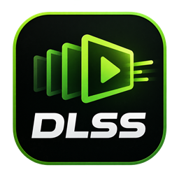
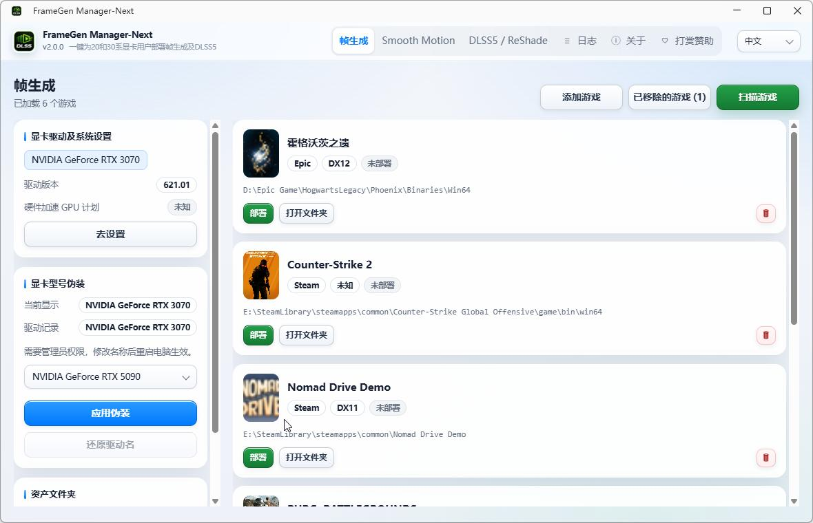
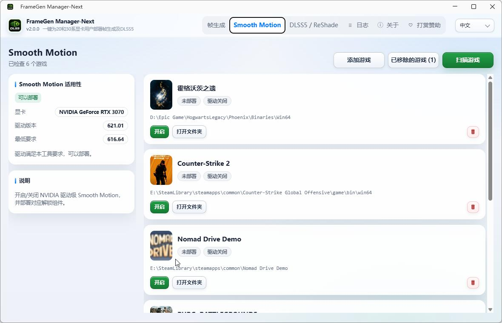
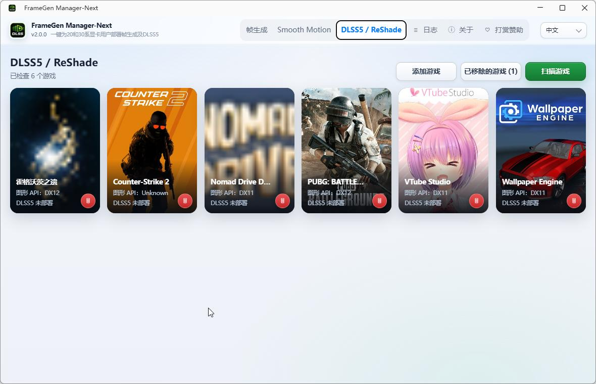

# FrameGen Manager-Next

[中文](README.md) | **English**

## What is this

Built primarily for NVIDIA RTX 20–50 series GPUs to deploy frame generation, with DLSS5 for RTX 20 / 30 series. ANR frame generation adds support for GTX 16 and RTX 20–50 series, AMD RX 5000–9000 series (including Steam Deck) and Intel Arc GPUs.

FrameGen Manager-Next is a rewrite of the [original FrameGen-Manager](https://github.com/XiaoQAQ10086/FrameGen-Manager), built from scratch as an independent implementation. It scans your game library, deploys frame generation and DLSS5 components into game folders, and supports reversible restore and cleanup.

It is **not** a frame generation renderer: frame generation itself is performed by the game, the NVIDIA runtime and ReShade. This tool only detects, deploys, configures and cleans up.

## Features

- **Game library scan**: Steam / Epic / loose game folders, with manual game adding and manual selection of the executable a game actually launches.
- **Frame generation deployment**: deploys SM75 / SM86 runtimes for RTX 20–50 series GPUs (assets 0.4.2; RTX 40/50 use the PTX kernels), with proxy slot, optimization level, 2X/3X/4X/6X, DLSS / XeSS engine, super-resolution mode and XeSS optical-flow settings. Deployments can be restored; files modified by the user are kept and reported as conflicts.
- **Smooth Motion**: writes the Smooth Motion switch into the game's driver profile and deploys the unlock component. The previous value is recorded before writing, the component is removed when disabled, and the original value is restored on restore.
- **DLSS5 / ReShade**: offline installation of the ReShade module, GITC Uplift components and standard shaders, with uninstall and legacy RenoDX cleanup.
- **Diagnostics and localization**: structured logs, diagnostic bundle export, and runtime Chinese/English switching.

| Smooth Motion | DLSS5 / ReShade |
|---|---|
|  |  |

## Why the original project was rewritten

As FrameGen-Manager grew and went through long-term iteration, structural problems became visible: blurred module boundaries, tight coupling between UI and core logic, and drifting public contracts. These made long-term maintenance increasingly difficult.

## Mode comparison

| Mode | GPUs | Game / system requirements | What gets deployed | Conflicts and limitations |
|---|---|---|---|---|
| Frame generation (SM86 / SM75) | NVIDIA RTX 20 / 30 / 40 / 50, driver ≥ 580.xx, latest recommended (40/50 use the PTX kernels) | The game supports DLSS Frame Generation | Proxy DLL + `dlssg_sm86` runtime (0.4.2) + INI | Mutually exclusive with Smooth Motion; competes for proxy DLLs with DLSS5/ANR; anti-cheat risk |
| Smooth Motion | NVIDIA RTX 20 / 30, driver ≥ 616.64 | The NVIDIA driver profile can be written | Driver profile switch + `version.dll` unlock component | Mutually exclusive with frame generation; not recommended for games with kernel anti-cheat |
| DLSS5 / ReShade | NVIDIA RTX 20 / 30 | The game's graphics API can be hooked by ReShade | ReShade + GITC Uplift + shaders/model | Competes for proxy DLLs with frame generation/ANR; works in 32-bit games; anti-cheat risk |
| ANR Full | NVIDIA RTX 20/30/40/50, GTX 16; AMD RX 5000/6000/7000/9000, Steam Deck; Intel Arc A/B | The game already offers DLSS Frame Generation; VC++ 2015-2022 x64 | OptiScaler full + ANR runtime + proxy | Experimental; competes for proxy DLLs with DLSS5/frame generation; anti-cheat risk |
| ANR Addon | Same as above | The game folder already has `OptiScaler.ini` | Writes to `OptiScaler/custom/Apex Neural Rendering FG/` and changes `[FrameGen]` | Requires OptiScaler; refuses to overwrite another ANR folder |
| REFramework (auxiliary) | Any GPU | RE Engine games only | `dinput8.dll` + revision file | Occupies `dinput8.dll`; frame generation must avoid that proxy |

## Requirements

- Windows 10 / 11 x64

## Architecture principles

- Rules and use cases do not depend on the UI or the operating system; platform capabilities are injected through ports.
- Asset files, target paths, proxy slots and install steps are data-driven, so upstream layout changes do not require code changes.
- Deployment, backup, restore and cleanup share one reversible state machine.
- The UI consumes a stable contract and never touches the file system or driver directly.
- New dependencies stay minimal and are recorded in an ADR.

## Acknowledgements and disclaimer

- Frame generation runtimes, Smooth Motion components and GITC Uplift assets come from their respective upstream projects; copyright belongs to the original authors. This repository does not contain those binary assets.
- Frame generation files: <https://github.com/sdli1995/dlssg_for_sm86>
- Smooth Motion files: <https://github.com/pipotoufikxyz-lgtm/dlssg_for_sm86-MFG-version>
- DLSS5 plugin: <https://github.com/ghostinthecamera/GITC-Uplift>
- ReShade: <https://github.com/crosire/reshade>
- DLSS5 model/render files for RTX 20 / 30 series were collected from the internet: <https://www.bilibili.com/video/BV1hXaA6jEDJ/?spm_id_from=333.1387.favlist.content.click&vd_source=ae80914c86306af292e3a6fe3e9444dd>
- ANR frame generation: <https://github.com/apex-compute/ANR>
- This is a community tool, not affiliated with NVIDIA, Intel or ReShade. No official support or warranty is provided.
- Check the game's terms of service and anti-cheat policy before use; do not deploy injected components into games with kernel anti-cheat.

## Feedback

If you run into problems or have suggestions, join our Tencent QQ groups: **1125445047** (group 2: **181592939**).

## License

Project code is licensed under the [MIT License](LICENSE).
