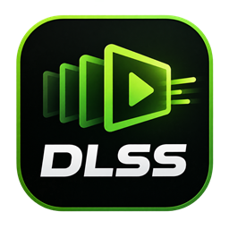
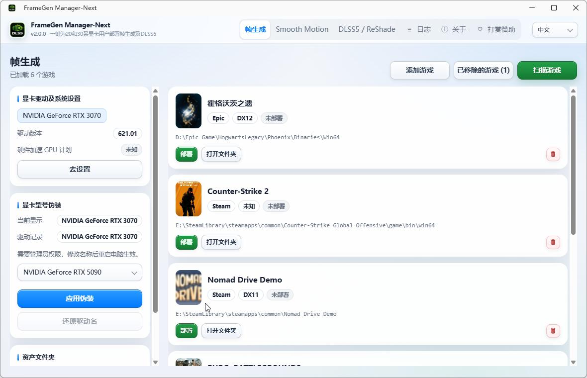
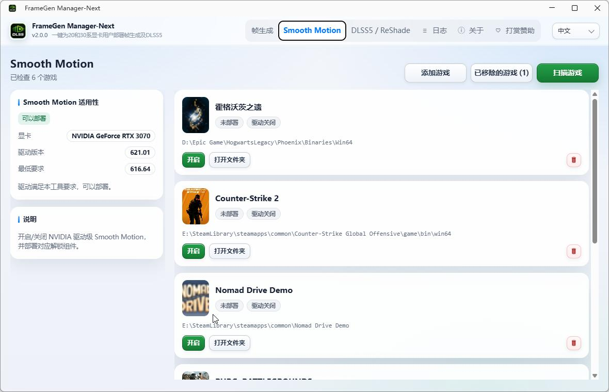
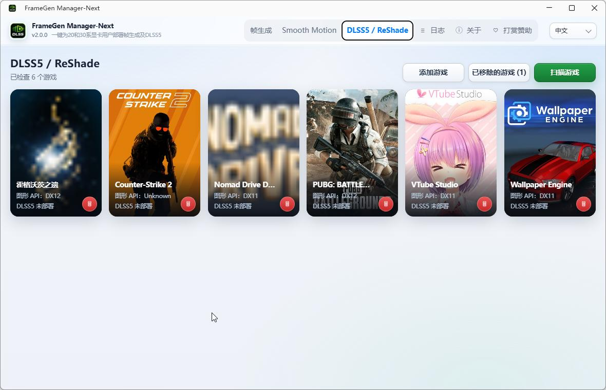

# FrameGen Manager-Next

**中文** | [English](README.en.md)

## 这是什么

主要面向英伟达 RTX 20–50 系显卡用户部署帧生成，并为 RTX 20 / 30 系提供 DLSS5。ANR 帧生成额外支持 GTX 16、RTX 20–50 系、AMD RX 5000–9000 系（含 Steam Deck）与 Intel Arc 显卡。

FrameGen Manager-Next 是[原项目 FrameGen-Manager](https://github.com/XiaoQAQ10086/FrameGen-Manager) 的重写版，从零独立实现。它负责扫描游戏库、把帧生成和 DLSS5 组件部署到游戏目录，支持可回滚的还原与清理。

它**不是帧生成渲染器**：真正的帧生成由游戏、NVIDIA 运行时和 ReShade 执行；本工具只做检测、部署、配置和清理。

## 功能

- **游戏库扫描**：Steam / Epic 散装目录，支持手动添加游戏和选择游戏实际启动的 EXE。
- **帧生成部署**：为 RTX 20–50 系显卡部署 SM75 / SM86 运行时（当前资产 0.4.2，RTX 40/50 走 PTX 内核），支持代理槽、优化等级、2X/3X/4X/6X、DLSS / XeSS 引擎、超分模式和 XeSS 光流参数；部署后可还原，被用户改过的文件会保留并报告冲突。
- **Smooth Motion**：为游戏写入驱动 profile 的 Smooth Motion 开关并部署解锁组件；写入前记录旧值，关闭时移除组件，还原时写回原值。
- **显卡名称伪装**：在管理员权限下修改驱动记录的显卡名称（固定 50 系白名单），写入前备份原始值，支持还原驱动名称或原始值；需要重启后在系统界面生效。
- **DLSS5 / ReShade**：离线安装 ReShade 模块、GITC Uplift 组件和标准 shader，支持卸载与旧版 RenoDX 清理。
- **诊断与本地化**：结构化日志、诊断包导出、中英文运行时切换。

| Smooth Motion | DLSS5 / ReShade |
|---|---|
|  |  |

## 为什么重写原项目FrameGen-Manager

原项目 FrameGen-Manager 随着功能增加和长期迭代，旧版逐渐暴露出结构性问题：模块边界模糊、UI 与核心耦合、公共契约漂移，不利于继续长期维护

## 模式对比

| 模式 | 支持显卡 | 游戏/系统前提 | 部署内容 | 主要冲突与限制 |
|---|---|---|---|---|
| 帧生成（SM86 / SM75） | NVIDIA RTX 20 / 30 / 40 / 50，驱动 ≥ 580.xx，建议保持最新（40/50 走 PTX 内核） | 游戏支持 DLSS Frame Generation | 代理 DLL + `dlssg_sm86` 运行时（0.4.2） + INI | 与 Smooth Motion 互斥；与 DLSS5/ANR 抢代理；反作弊风险 |
| Smooth Motion | NVIDIA RTX 20 / 30，驱动 ≥ 616.64 | NVIDIA 驱动 profile 可写 | 驱动 profile 开关 + `version.dll` 解锁组件 | 与帧生成互斥；内核反作弊游戏不建议 |
| DLSS5 / ReShade | NVIDIA RTX 20 / 30 | 游戏图形 API 可被 ReShade 接管 | ReShade + GITC Uplift + shader/模型 | 与帧生成/ANR 抢代理；32 位游戏可用；反作弊风险 |
| ANR Full | NVIDIA RTX 20/30/40/50、GTX 16；AMD RX 5000/6000/7000/9000、Steam Deck；Intel Arc A/B | 游戏已有 DLSS Frame Generation；VC++ 2015-2022 x64 | OptiScaler full + ANR 运行时 + 代理 | 实验性；与 DLSS5/帧生成抢代理；反作弊风险 |
| ANR Addon | 同上 | 游戏目录已有 `OptiScaler.ini` | 写入 `OptiScaler/custom/Apex Neural Rendering FG/`，修改 `[FrameGen]` | 需要有 OptiScaler；已有其他 ANR 目录会拒绝 |
| REFramework（辅助） | 不限 GPU | 仅 RE Engine 游戏 | `dinput8.dll` + revision 文件 | 占用 `dinput8.dll`；帧生成必须避开该代理 |

## 环境要求

- Windows 10 / 11 x64

## 致谢与声明

- 帧生成运行时、Smooth Motion 组件和 GITC Uplift 资产来自对应上游项目，版权归原作者所有，仓库不包含这些二进制资产
- 帧生成文件来自：https://github.com/sdli1995/dlssg_for_sm86
- Smooth Motion文件来自：https://github.com/pipotoufikxyz-lgtm/dlssg_for_sm86-MFG-version
- DLSS5插件来自：https://github.com/ghostinthecamera/GITC-Uplift
- Reshade：https://github.com/crosire/reshade
- DLSS5的20和30系模型渲染文件来自互联网收集：https://www.bilibili.com/video/BV1hXaA6jEDJ/?spm_id_from=333.1387.favlist.content.click&vd_source=ae80914c86306af292e3a6fe3e9444dd
- ANR帧生成：https://github.com/apex-compute/ANR
- 本项目是社区工具，与 NVIDIA、Intel、ReShade 官方无关，不提供任何官方支持或担保
- 使用前请自行确认游戏的服务条款和反作弊策略；带内核反作弊的游戏不要部署注入组件。

## 反馈

如果您遇到任何问题或有更好的建议，欢迎加入腾讯 QQ 群：**1125445047**（2 群：**181592939**）交流与反馈

## 许可证

本项目代码使用 [MIT License](LICENSE)。
