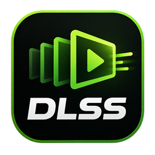
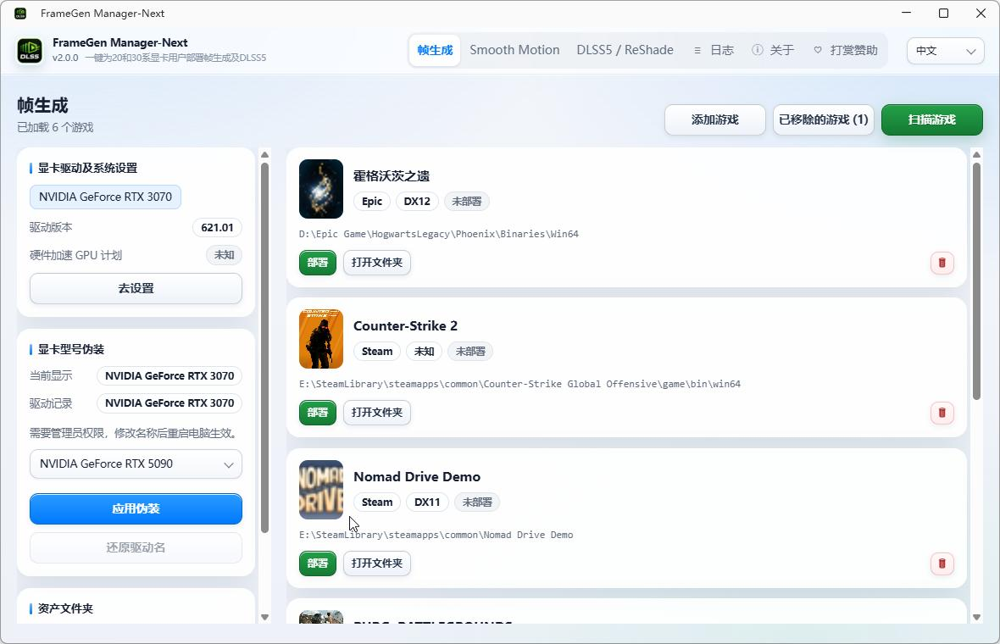
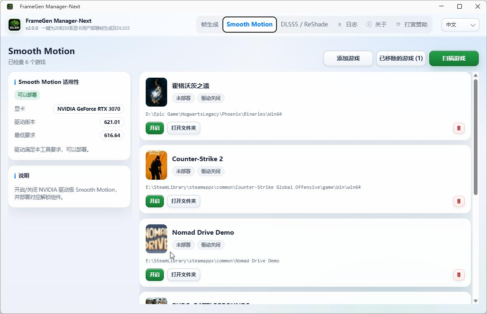
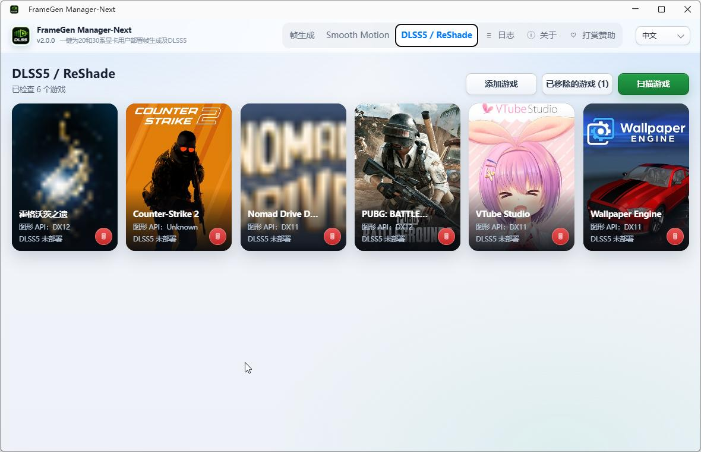

<p align="center"></p>

# FrameGen Manager-Next

**中文** | [English](README.en.md)

[](https://github.com/XiaoQAQ10086/FrameGen-Manager-Next/actions/workflows/ci.yml)
[](LICENSE)
[](#环境要求)
[](#技术栈)

## 这是什么

一键为英伟达 20 / 30 系显卡用户部署帧生成及 DLSS5。

FrameGen Manager-Next 是[原项目 FrameGen-Manager](https://github.com/XiaoQAQ10086/FrameGen-Manager) 的重写版，使用 **C# / .NET 10 LTS** 从零实现。它负责扫描游戏库、把帧生成和 DLSS5 组件部署到游戏目录，支持可回滚的还原与清理。

它**不是帧生成渲染器**：真正的帧生成由游戏、NVIDIA 运行时和 ReShade 执行；本工具只做检测、部署、配置和清理。



## 功能

- **游戏库扫描**：Steam / Epic 散装目录，支持手动添加游戏和选择游戏实际启动的 EXE。
- **帧生成部署**：为 RTX 20 / 30 系显卡部署 SM75 / SM86 运行时，支持代理槽、优化等级、2X/3X/4X/6X、DLSS / XeSS 引擎、超分模式和 XeSS 光流参数；部署后可还原，被用户改过的文件会保留并报告冲突。
- **Smooth Motion**：为游戏写入驱动 profile 的 Smooth Motion 开关并部署解锁组件；写入前记录旧值，关闭时移除组件，还原时写回原值。
- **DLSS5 / ReShade**：离线安装 ReShade 模块、GITC Uplift 组件和标准 shader，支持卸载与旧版 RenoDX 清理。
- **显卡型号伪装**：在管理员权限下修改驱动记录的显卡名称，支持应用、还原驱动名和恢复原始值，重启后生效。
- **诊断与本地化**：结构化日志、诊断包导出、中英文运行时切换。

| Smooth Motion | DLSS5 / ReShade |
|---|---|
|  |  |

## 为什么需要重写原项目FrameGen-Manager

原项目 FrameGen-Manager 随着功能增加和长期迭代，旧版逐渐暴露出结构性问题：模块边界模糊、UI 与核心耦合、公共契约漂移，不利于继续长期维护

## 支持的组件

| 组件 | 适用显卡 | 说明 |
|---|---|---|
| 帧生成（SM86 / SM75） | RTX 30 / 20 系 | 代理 DLL + `dlssg_sm86` 运行时，支持 DLSS 与 XeSS 引擎 |
| Smooth Motion | RTX 30 / 20 系，驱动 ≥ 616.64 | 驱动 profile 开关 + 解锁组件；带内核反作弊的游戏会被拒绝 |
| DLSS5 / ReShade | 按游戏图形 API | 离线 ReShade + GITC Uplift + 标准 shader |
| 显卡型号伪装 | NVIDIA 独显 | 需要管理员权限，重启后生效 |

帧生成与 Smooth Motion 在同一个游戏上互斥：一方开启时，另一方会显示红色冲突徽章并锁定操作，避免两个注入器同时进入游戏进程


## 技术栈

| 层 | 选型 |
|---|---|
| 运行时 | .NET 10 LTS（`net10.0-windows`） |
| 宿主 | WPF + Wpf.Ui（仅窗口外壳） |
| 界面 | WebView2 + 本地 HTML/CSS/JS |
| 组合 | Microsoft.Extensions.Hosting / DI |


依赖版本集中在 [`Directory.Packages.props`](Directory.Packages.props)。核心扩展与测试断言使用当前最新的预览/RC 版本，Serilog 与 Velopack 保持稳定版；运行时保持 .NET 10 LTS

## 环境要求

- Windows 10 / 11 x64
- .NET 10 SDK 10.0.403 或更新

## 项目结构

```text
src/
  FrameGenManagerNext.Domain/          模型、规则、错误码、资产包协议
  FrameGenManagerNext.Core/            用例服务与端口接口
  FrameGenManagerNext.Infrastructure/  Windows、文件、NVAPI、ReShade、资产包实现
  FrameGenManagerNext.App/             WPF 宿主 + WebView2 界面
  FrameGenManagerNext.Cli/             无 UI 验收入口
tests/                                 Domain / Core / Infrastructure / Integration 测试
docs/behavior/                         每个模块的行为规格
build/                                 生成资产包、校验、发布脚本
```

依赖方向：`Domain ← Core ← Infrastructure`，`App` / `Cli` 只在组合根引用 Infrastructure。Core 与 Domain 不引用 WPF/WinForms，所有 P/Invoke 只出现在 Infrastructure


## 致谢与声明

- 帧生成运行时、Smooth Motion 组件和 GITC Uplift 资产来自对应上游项目，版权归原作者所有，仓库不包含这些二进制资产
- 帧生成文件来自https://github.com/sdli1995/dlssg_for_sm86
- Smooth Motion文件来自https://github.com/pipotoufikxyz-lgtm/dlssg_for_sm86-MFG-version
- DLSS5插件来自https://github.com/ghostinthecamera/GITC-Uplift
- Reshade：https://github.com/crosire/reshade
- DLSS5的20和30系模型渲染文件来自互联网收集：https://www.bilibili.com/video/BV1hXaA6jEDJ/?spm_id_from=333.1387.favlist.content.click&vd_source=ae80914c86306af292e3a6fe3e9444dd
- 本项目是社区工具，与 NVIDIA、Intel、ReShade 官方无关，不提供任何官方支持或担保
- 使用前请自行确认游戏的服务条款和反作弊策略；带内核反作弊的游戏不要部署注入组件

## 反馈

如果您遇到任何问题或有更好的建议，欢迎加入腾讯 QQ 群：**1125445047**（2 群：**181592939**）交流与反馈

## 许可证

本项目代码使用 [MIT License](LICENSE)。
